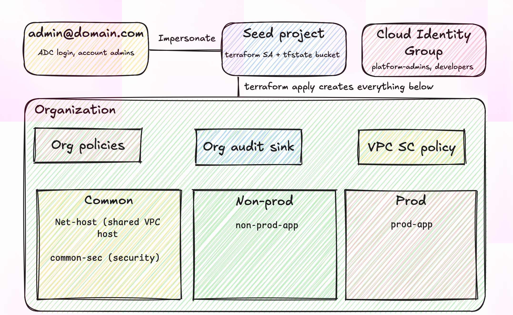

# GCP Landing Zone (Terraform)

The context of this project is to act as a newly-founded Financial Technology firm, aiming on a cloud-native company, where a Landing Zone forms a foundation for initial development.

In this project, a Google Cloud foundation built from scratch with Terraform focussing on resource hierarchy, project factory, group-based IAM, organisation policy guardrails, Shared VPC, central audit logging, CMEK and a VPC Service Controls perimeter, with an automated test script that proves each control works.

> Built as a personal project to mirror the AWS landing zone work I do professionally (account vending, SCPs, Identity Center) on Google Cloud, and to explore GCP, as my professional work now involves introducing GCP across the organisation.



## What it builds

| Area | What | GCP services |
|---|---|---|
| Hierarchy | `common`, `non_prod`, `prod` folders; one project per workload and environment | Resource Manager |
| Project factory | New project = one entry in a map (folder, APIs, labels) | `google_project` + `for_each` |
| Identity | Access granted to groups only; developers write in non-prod, read-only in prod | Cloud Identity, IAM |
| Guardrails | No Service Account (SA) keys, London-only resources, no external IPs, no public buckets, domain-restricted sharing, OS Login | Organisation Policy |
| Network | Shared VPC host with per-environment subnets, IAP-only SSH, logged default deny | VPC, Firewall, IAP |
| Logging | Org-wide audit log sink into a security-owned bucket | Cloud Logging |
| Encryption | Keys held in the security project, used by prod storage | Cloud KMS (CMEK) |
| Data perimeter | Prod project behind a perimeter, rolled out dry-run first | VPC Service Controls |

## Design decisions

- **Seed project outside the folders** holds Terraform state and the Terraform service account, so the landing zone can never delete its own state.
- **Impersonation, no keys:** Terraform runs as a dedicated service account via short-lived tokens; in CI this would be Workload Identity Federation.
- **Additive IAM (`_iam_member`)** rather than authoritative policies, to avoid wiping bindings while iterating.
- **Perimeter in dry-run before enforce**, the same way it would be rolled out in a regulated environment.
- _Add your own: what you would change for production, e.g. `PREVENT` deletion policy, locked log retention, PAM for admin access._

## Repository layout

```
landing-zone/
  versions.tf        # providers + GCS backend (impersonated)
  variables.tf
  hierarchy.tf       # folders + project factory
  iam.tf
  org_policies.tf
  network.tf
  logging.tf
  kms.tf
  vpcsc.tf
  terraform.tfvars   # contains variables for terraform
  test.sh # proves each control by trying to break it
```

## Prerequisites

- A Google Cloud organisation (Cloud Identity Free + your own domain) and a billing account
- `gcloud` and Terraform >= 1.6
- Groups `platform-admins@` and `developers@` in Cloud Identity

## Deploy

```bash
# 1. Bootstrap (once): seed project, state bucket, Terraform service account
#    see docs/bootstrap.md

# 2. Configure
cp terraform.tfvars.example terraform.tfvars   # set org_id, billing_account, prefix, domain, customer_id

# 3. Apply
gcloud auth application-default login           # as your admin user
terraform init
terraform plan
terraform apply
```

## Proving the guardrails

```bash
PREFIX=<PREFIX_IN_TFVARS> ./test.sh
```

| Control | Test | Expected |
|---|---|---|
| No SA keys | Create a service account key | Denied by `iam.disableServiceAccountKeyCreation` |
| Data residency | Create a bucket in `us-central1` | Denied by `gcp.resourceLocations` |
| No public IPs | Create a VM with an external IP | Denied by `compute.vmExternalIpAccess` |
| IAP access | SSH to a private VM through IAP | Succeeds |
| Audit trail | Read denied calls from the central bucket | Entries present |
| Perimeter | Copy to prod bucket (dry run, then enforced) | Logged, then blocked |

Detailed logs available on `test.log`.

## Cost

Idle, the foundation costs well under £1/month (KMS key versions and a few MB of storage). Compute, NAT and load balancers are where cost comes primarily from. A £10 budget alert is configured.

## Tear down

```bash
terraform destroy          # put the perimeter back into dry-run first
gcloud projects delete <prefix>-seed
```

## Version 2 aims at

- CI pipeline (GitHub Actions + Workload Identity Federation) with `terraform plan` on PRs
- Policy-as-code checks before apply (e.g. OPA / `gcloud beta terraform vet`)
- Modules per component so the factory can be reused across business units

## Lessons learned (... so far)

<!-- Short and honest; reviewers like this. Example: -->
- `terraform init` impersonation failed because application-default credentials were on a personal account, not the org admin; fixed by re-running `gcloud auth application-default login` with the right account and full scopes.
